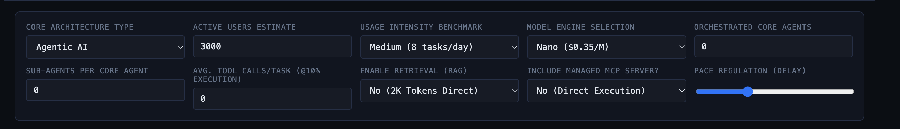
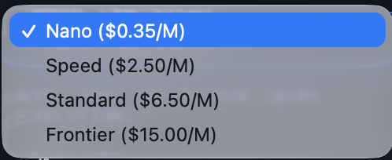
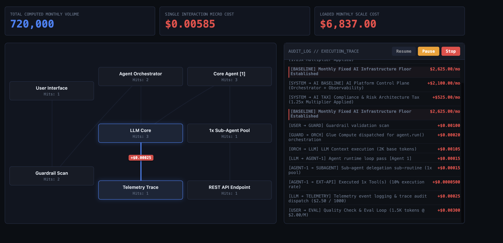

# Overview

FERMI is Framework for Estimating Resource, Model & Infrastructure costs, named after Italian physicist Enrico Fermi

It is a a micro-transaction cost simulation engine for AI topologies.\
Usually, when we speak about AI and Agents , we only talk about the token costs of the LLMs. Gartner suggests that 40% of the agentic AI projects will be cancelled by 2027 due to escalating infra overhead, spiralling costs to name a few.

FERMI makes the hidden economics of an AI architecture visible. It models how architectural components contribute to the cost of a single user interaction and how those costs accumulate at monthly scale. It is not intended to prescribe technology choices or constrain AI adoption, but to provide engineering teams and decision-makers with a transparent view of the financial implications of their architectural decisions.

So FERMI will help you see overall monthly costs of your Agentic AI architecture and also micro transaction costs. The first version (v1.0) focuses on Agentic AI architecture only.

I have seen even for a simple regression problem, companies wants to invest in LLM and ride the hype but there is a need to understand when to use LLM, when is it easier to just build and manage traditional ML or DL models and when hybrid is required

At the POC stage, the costs seems to be lower, you might use cost effective base LLM models, the token costs, user and the token usage might not just be ????

For users, they see just one interaction. Submit a request, receive a response.
The engineering team decides what happens behind the scenes, do they need orchestration, agents, sub-agents, LLM calls, tools, MCP, RAG etc.

Each of those architectural decisions can add cost to that apparently simple interaction.
At scale, the cumulative cost becomes significant, even if the cost of an individual interaction looks negligible.

:::{.callout-tip}
FERMI is acost transparency and architecture awareness tool for engineering and CXOs.
:::

# Simulation Inputs

It has a very simple UI. You add and select the required details. Let us review them in detail.

{fig-align="left"}

## Architecture

You can select different type of architecture. By Default it is **Agentic AI** for version 1.0. Later version would include **Traditional AI** and **Hybrid Architecture**

## Active User

Provide an estimate of number of active users

## Usage Intensity

What would be the average number of requests send to the LLMs?, You have

1.  High with 35 tasks/day
2.  Medium with 8 tasks (default value)
3.  Low with just 1.5 tasks/day

## Model Engine

Which LLM would you like to choose. For example Nano which is a very small model is charged approx \$0.35 per million token.

::: callout-warning
Note: This could change depending on when you are reading this.
:::

{fig-align="left"}

## Avg. Tool (API)

The Agents might call external API which has costs associated with it.

## Core Agents & Sub Agents

Mention how many agents and sub agents would you typically need

## MCP & RAG

Do you need managed MCP and RAG servers

# Outputs & Audit logs

Top of the section contains total compute volume, single transaction costs and monthly scale cost.
This section of the page shows the per transaction costs and also the audit trail. 

Next, let us look at how these calculations are done

